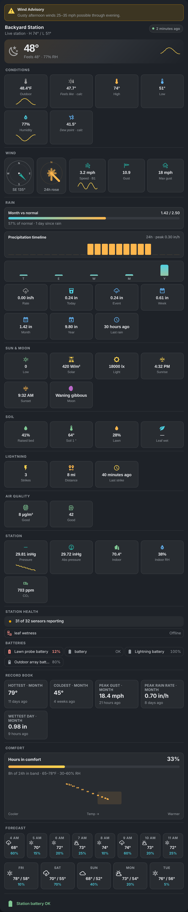
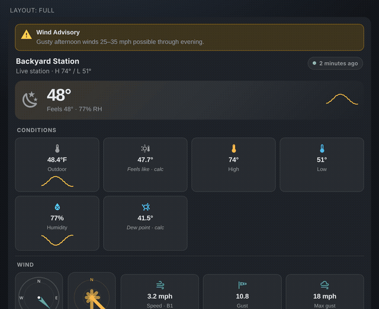
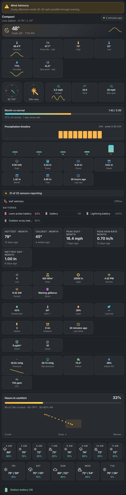
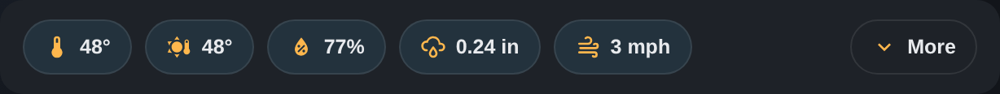
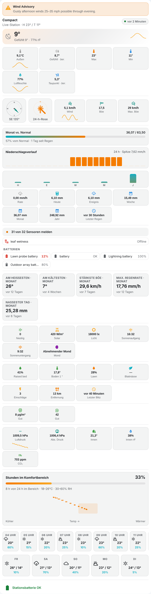

# Mushroom Weather Station Card

A Lovelace card for **personal weather station** sensors (Ecowitt, Ambient, Fine Offset, and similar). One `prefix` maps every sensor; you get a live dashboard with history graphs, a record book, station health, comfort zones, forecasts, and weather alerts — in five languages.

[](https://www.home-assistant.io)
[](https://hacs.xyz)
[](https://github.com/highergroundstudio/lovelace-mushroom-weather-station-card/releases)
[](https://github.com/highergroundstudio/lovelace-mushroom-weather-station-card/actions/workflows/validate.yaml)
[](LICENSE)

**[▶ Try the live demo](https://highergroundstudio.github.io/lovelace-mushroom-weather-station-card/)** — simulated sensors, no Home Assistant needed.

<p align="center">
  
  &nbsp;
  
</p>

[](https://my.home-assistant.io/redirect/hacs_repository/?owner=highergroundstudio&repository=lovelace-mushroom-weather-station-card&category=plugin)

## Features

- **One prefix** maps Ecowitt-style entity IDs (`sensor.ws_temperature`, `sensor.ws_daily_rain`, …); override any slot with an entity picker
- **Three layouts** — `full`, `compact`, and a one-line `chips` glance bar
- **Graph popup** — tap a tile for a 24 h / 7 d / 30 d chart with min–max band, hover/arrow-key readout, and min/avg/max
- **Record book** — month or year extremes from Home Assistant **long-term statistics**, so a full year works even though raw history is purged after 10 days
- **Station health** — offline and silent sensors, every transmitter battery (auto-discovered), signal strength
- **Calculated values** — feels-like (NWS wind chill / heat index) and dew point (Magnus) when your station has no sensor for them
- **Translations** — English, Deutsch, Français, Español, Nederlands; follows your HA language and number format
- **Accessible** — keyboard operable, screen-reader labels on every tile and chart, visible focus, reduced-motion support
- History sparklines, wind compass + rose, precipitation timeline, comfort zones (temp × humidity)
- Hourly + daily forecast, weather alerts banner, sunrise / sunset / moon
- Soil moisture/temperature 1–8, leaf wetness, lightning, PM2.5, AQI, VOC, noise, CO₂
- Seasonal skins, stale-data warning, pressure trend, rain month vs normal
- Mushroom itself is **not required**

| Compact | Chips | Deutsch · metric · light |
| --- | --- | --- |
|  |  |  |

## Install with HACS

1. HACS → **Custom repositories**
2. URL: `https://github.com/highergroundstudio/lovelace-mushroom-weather-station-card`
3. Type: **Dashboard**
4. Download **Mushroom Weather Station Card**
5. Hard-refresh the browser (Ctrl+F5)

```yaml
url: /hacsfiles/lovelace-mushroom-weather-station-card/mushroom-weather-station-card.js
type: module
```

Both files must sit in the same folder after install:

- `mushroom-weather-station-card.js` — card
- `mushroom-weather-station-card-editor.js` — visual editor (loaded when you open Edit)

### Not seeing the new version?

1. HACS → Frontend → **Mushroom Weather Station Card** → check for updates / redownload
2. Hard-refresh the browser (Ctrl+F5 / Cmd+Shift+R)
3. Open the card editor and confirm the banner shows **Mushroom Weather Station Card · v0.9.0**
4. If the banner is stale, clear the Lovelace resource cache or bump the resource URL with `?v=0.9.0`

HACS only sees published **GitHub releases** (not commits on `main`).

## Add the card

```yaml
type: custom:mushroom-weather-station-card
name: Backyard Station
prefix: ws
layout: full
unit_system: native
weather_entity: weather.home   # for hourly / daily forecast and alerts
graph_popup: true
```

That is enough for most Ecowitt setups. Everything below is optional.

## Options

```yaml
unit_system: imperial   # native | imperial | metric
language: de            # en | de | fr | es | nl — default: your HA language
tablet_mode: true       # tap does nothing, hold for more-info
graph_popup: true       # tap numeric tiles for the history graph (default false)
derive_missing: true    # calculate feels-like / dew point when missing (default true)
show_forecast: true
show_hourly_forecast: true
hourly_forecast_hours: 24
forecast_days: 5
show_history_sparklines: true
history_hours: 24
show_wind_rose: true
show_alerts: true
show_precip_timeline: true
show_records: true
records_period: month   # or year
show_comfort: true
comfort_temp_min: 65    # °F stored; the editor shows °C when metric
comfort_temp_max: 78
comfort_humidity_min: 30
comfort_humidity_max: 60
seasonal_skins: true
hemisphere: north       # or south
weather_entity: weather.home
alert_entity: binary_sensor.nws_alert   # optional
sun_entity: sun.sun
moon_entity: sensor.moon_phase
rain_month_normal: 2.5  # in the month-rain sensor's own unit
show_updated: true
stale_minutes: 30
show_beaufort: false
battery_warning_threshold: 20
battery_entities:       # optional; auto-detected from prefix when omitted
  - sensor.ws_wh65_battery
  - sensor.ws_wh51_ch1_battery
section_order:
  - conditions
  - wind
  - rain
  - sun
  - soil
  - lightning
  - air
  - station
  - health
  - records
  - comfort
  - forecast
  - battery
hide_conditions: false  # also hide_wind, hide_rain, hide_sun, hide_soil, hide_lightning,
hide_health: false      # hide_air, hide_more, hide_records, hide_comfort, hide_battery
entities:
  signal_strength: sensor.ws_gateway_rssi   # optional, shown in Station health
thresholds:
  # Cutoffs are compared in imperial (°F / mph), even when unit_system is metric.
  # The visual editor converts °C / km/h inputs for you; YAML values must use °F / mph.
  uv:
    - above: 8
      color: purple
  temperature:
    - below: 32
      color: blue
labels:
  temperature: Outside
  soil_moisture_1: Raised bed
units:
  rain_today: in
actions:
  rain_today:
    tap_action:
      action: graph     # graph | more-info | navigate | url | call-service | none
    hold_action:
      action: more-info
```

### Graph popup

With `graph_popup: true`, tapping a numeric tile opens a chart instead of more-info. You can also set `action: graph` on any tile under `actions`. 24 h uses recorded states; 7 d and 30 d use hourly long-term statistics (min–max band with a mean line), falling back to recorded states for sensors without statistics. Hover, or focus the chart and use ← / → / Home / End, to read individual values. **More info** in the popup opens the normal dialog.

### Record book and long-term statistics

Home Assistant keeps raw history for `purge_keep_days` (10 days by default), so a "month" or "year" record book built from raw history silently covered only the last 10 days. Since 0.9 the record book reads **long-term statistics**, which are kept forever. They exist for sensors with a `state_class` (`measurement` for temperature, gust, rain rate; `total_increasing` works for daily rain). Most weather integrations set this already. If a sensor has no statistics, the card falls back to raw history for it and says so under the records.

### Station health

Lists mapped sensors that are `unavailable` or have not reported for `stale_minutes` (uses `last_reported`, HA 2024.3+), and every battery entity sharing your prefix — low ones first. Set `battery_entities` to choose them yourself, and the `signal_strength` entity slot to show gateway signal. The section hides itself when there is nothing to show.

### Calculated values

When `feels_like` or `dew_point` is missing or unavailable, the card computes it from temperature, humidity and wind speed (NWS wind chill ≤ 50 °F, NWS heat index ≥ 80 °F, Magnus dew point). Calculated tiles are labeled "· calc". Turn off with `derive_missing: false`.

### Translations

The card follows your Home Assistant language and number format (`21,5` vs `21.5`); override with `language`. Card text is fully translated in English, German, French, Spanish and Dutch; editor help text falls back to English where a translation is missing. To add a language, copy [`src/i18n/de.ts`](src/i18n/de.ts), translate, and register it in [`src/i18n/index.ts`](src/i18n/index.ts) — missing keys fall back to English, so partial translations are welcome.

### Accessibility

Every tile, chip, forecast item, compass and chart is keyboard reachable (Tab, Enter/Space) and has a spoken label ("Outdoor: 71.2°F"). Charts expose a text summary, progress bars use `progressbar` semantics, the graph popup is a modal dialog that returns focus to the tile that opened it, and animations respect `prefers-reduced-motion`. Updates no longer rebuild the card, so focus and hover survive live sensor changes.

## Develop

```bash
npm install
npm test
npm run build              # type-check, then writes dist/*.js
npm run demo               # http://127.0.0.1:8765/demo/
node scripts/screenshots.mjs  # regenerate images/ (needs Playwright + ffmpeg)
```

Source lives in `src/` — `card.ts` (lifecycle, data, events), `sections/` (one file per section), `i18n/`, `data.ts` (history + statistics), `health.ts`, `derived.ts`, `graph.ts`, `morph.ts`. HACS ships the committed files in `dist/`; CI fails if they do not match a fresh build.

Pushing a new `package.json` version to `main` triggers **Auto Release** so HACS can update. The **Demo site** workflow publishes `demo/` to GitHub Pages (enable once under Settings → Pages → Source: GitHub Actions).

## Just to be clear

This project is **not affiliated with, endorsed, or supported by** the Home Assistant project or by the Mushroom Cards authors. It is provided as-is.

## Contributing

Bugs and ideas: use the GitHub issue templates (bug / feature). Pull requests against `main` are welcome — see [CONTRIBUTING.md](CONTRIBUTING.md).

## License

MIT — see [LICENSE](LICENSE).
