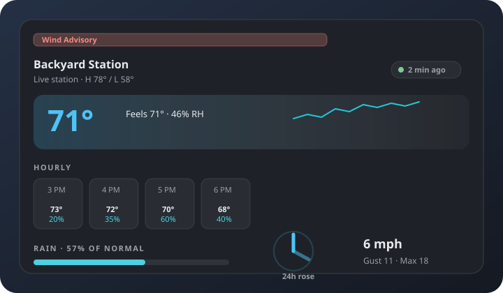

# Mushroom Weather Station Card

Lovelace card for personal weather station sensors (Ecowitt, Ambient, Fine Offset, and similar).



## Highlights

- One `prefix` field maps Ecowitt-style entities
- Home Assistant entity pickers for every override
- Layouts: `full`, `compact`, `chips`
- Threshold colors, wind compass, rain sparkline
- Soil moisture, lightning, and PM2.5 sections
- Stale-data warning and pressure trend
- Optional forecast from a `weather.*` entity (with precip %)
- Mushroom is not required

## Example

```yaml
type: custom:mushroom-weather-station-card
name: Backyard Station
prefix: ws
layout: full
show_updated: true
stale_minutes: 30
```
